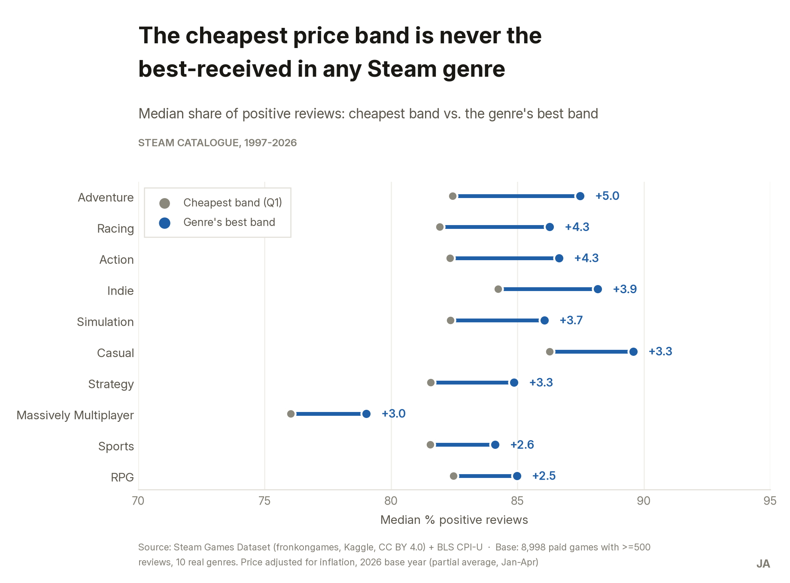

# Job-search collateral

Ready to reuse for LinkedIn, the CV, and a "tell me about a project" answer. This is *not* site
content — the site's home-page card (L1) is generated from `index.md`'s front-matter in the
`site` repository. This file is copy for channels the site doesn't cover.

---

## LinkedIn post

> ### On Steam, the cheapest price band is never the best-received, in any of 10 genres
>
> 
>
> I analysed Steam's historical catalogue — 125,855 games — with Python and pandas to answer a
> question from an investment fund: which genre is worth prioritising for due diligence. I
> combined the catalogue with the BLS CPI-U index to compare 29 years of prices in real dollars,
> and found that games under $3.25 never get the best reception in their genre, and in 9 of 10
> genres they get the worst. I checked the obvious objection — that cheap games are just old
> games — and it is partly right: among recent games the pattern holds only in Adventure, Indie
> and Casual. Those are the three genres I recommended for due diligence, and stated plainly that without revenue data this says
> where to look, not where to put the money.
>
> `Python` `pandas` `matplotlib` `2 sources combined` `125,855 games`
> · [See the full case →](https://juanesportfolio.com/cases/steam-price-reception/)

## Short version (LinkedIn, CV)

> **On Steam, the cheapest price band is never the best-received, in any of 10 genres.** I
> analysed 125,855 games with Python and pandas, adjusting prices for inflation with the BLS
> CPI-U, and found the cheapest band is the worst in 9 of the 10 genres, with the pattern clearest
> among older games. Basis for a due-diligence prioritisation recommendation for an investment
> fund: Adventure, Indie and Casual.

## One-sentence version (15 seconds)

> On Steam, cheap doesn't buy good reception: the lowest price band is never the best in any of
> ten genres, and the worst in nine.

## CV line

> Analysed 125,855 Steam games combined with the CPI-U index to identify the price/reception
> pattern by genre; the result — the cheapest band is never the best-received in any of 10
> genres, with a 2.5-5.0 p.p. gap to the best band — was the basis for a due-diligence prioritisation recommendation
> for an investment fund.

---

## Portfolio coverage matrix

| Case | Problem type | Main tool | Domain | Data type | What it demonstrates |
|---|---|---|---|---|---|
| **Steam: price and reception** | Find patterns | Python (pandas) | Video games / digital platforms | Cross-sectional, structured, two sources combined | Cleaning a real structural flaw (broken header), enrichment with a second source (CPI-U) for temporal comparability, and explicitly ruling out the alternative explanation before publishing |
| Case 2 | | | | | |
| Case 3 | | | | | |

**Gaps identified after this case:**

- **Problem types not covered:** predict, categorise, spot something unusual, identify themes,
  discover connections. This case covers only "find patterns".
- **Tools not demonstrated:** SQL and a BI tool (Tableau or Power BI). This case is entirely
  Python.
- **Data type not covered:** true longitudinal (time series with the same unit observed over
  time). Here, age is a cross-sectional proxy, not a series.
- **Any case where the result contradicted the starting hypothesis?** Partially. The intuitive
  hypothesis "more expensive, better reception" was half-right: the peak isn't at the highest
  price but at mid-to-high. Still missing a case where the conclusion runs squarely against the
  starting assumption.

**The next case should:** use **SQL** as the lead tool, on **longitudinal** data, and ideally a
different problem type (spot something unusual or categorise). A domain outside video games —
health, retail or mobility — would also broaden sector coverage.
